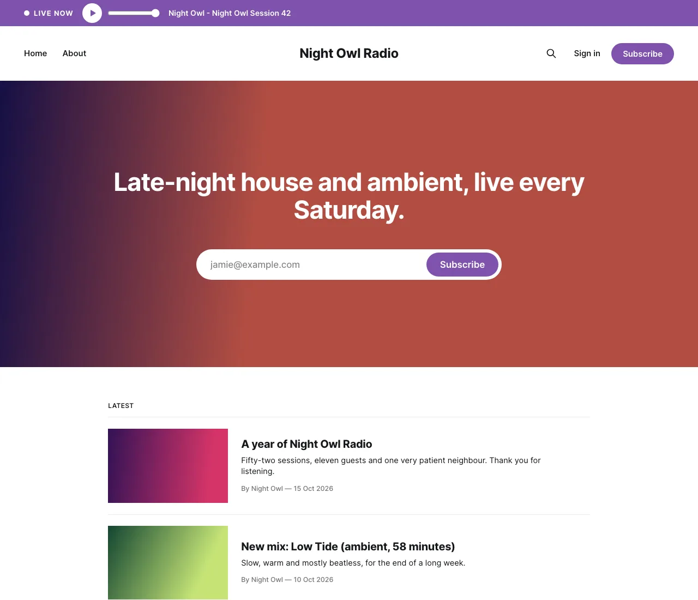
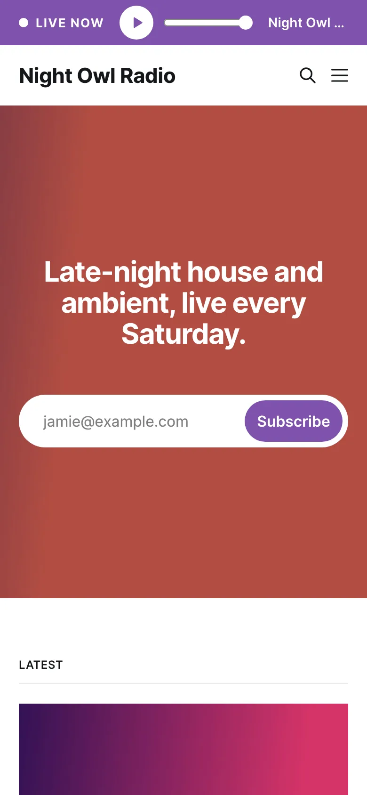
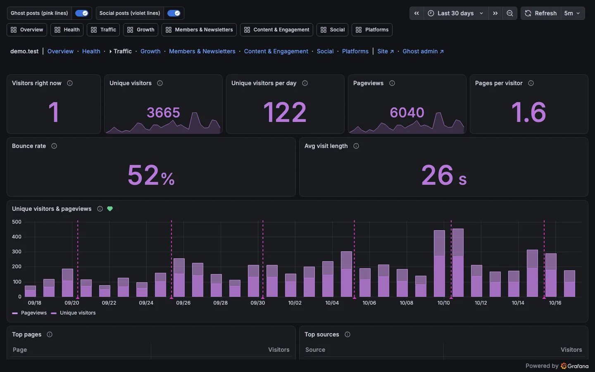
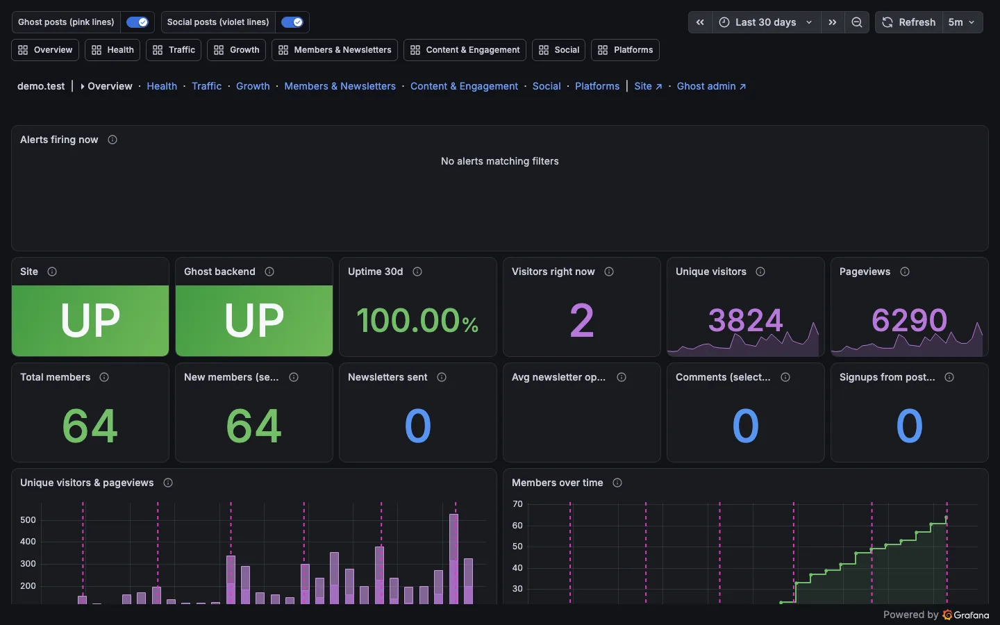
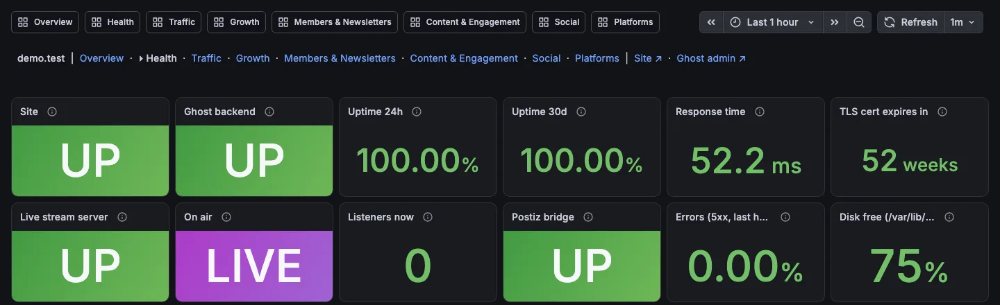

# Puppi3's Creator Kit 🐾

[](LICENSE)
[](https://github.com/puppi3-music/puppi3-creator-kit/releases)

A self-hosted home for your work as a creator: a Ghost website and newsletter, web analytics with no third party, a
live stream with a LIVE NOW bar, each post shared to your social networks, every network's numbers in one set of
Grafana dashboards, and alerts on your phone. It all runs on one machine with Docker Compose, or on Kubernetes (your
own cluster, Amazon EKS or Google GKE).

**Guides:** [Setup](kit/docs/setup-guide.html) · [Operations](kit/docs/operations-guide.html) · [Networks](kit/docs/networks-guide.html) ·
[Cloud](kit/docs/cloud-guide.html) · [Theme](kit/docs/theme-guide.html) · [Posting](kit/docs/posting-guide.html) · [Analytics](kit/docs/analytics-guide.html) ·
[Settings reference](kit/docs/settings-reference.html) (online at
[puppi3-music.github.io/puppi3-creator-kit](https://puppi3-music.github.io/puppi3-creator-kit/kit/docs/))

## What it looks like



| On a phone | The Traffic dashboard |
|---|---|
|  |  |





*Screenshots from a made-up demo site.* Not pictured: when you publish a post, the bridge shares it to your networks,
and Ghost's Preview of a draft gets a Social preview button that shows what each network would get.

## What you get

The site is always there. Each other part is a module you switch on in your site's `MODULES`.

| Module | What it does | What it needs from you |
|---|---|---|
| (always on) | Ghost 6 with MySQL, behind Traefik (https, and optionally only reachable through Cloudflare); the kit's theme (Ghost's Source with the kit's extras) | A domain and its DNS; an email address for Let's Encrypt |
| `analytics` | Ghost's own web analytics (Tinybird, run locally), with each visitor's country | Nothing |
| `live` | A live audio stream (TinyIce) for a radio show, a live podcast or a DJ set: your streaming software sends to it, and the site shows a LIVE NOW bar that plays it | Software that streams Ogg to Icecast (butt, Mixxx, Traktor, ffmpeg...) |
| `social` | Postiz, plus a bridge that shares each Ghost post to your networks, draws social previews of drafts, counts clicks and collects every network's numbers | A developer app for each network you post to (their keys go in `secrets/postiz.env`); optional keys for SoundCloud, Cloudflare and Search Console numbers |
| `monitoring` | Grafana with the dashboards (traffic, growth, members, content, social, each platform, each post) and alerts to your phone; Prometheus, which collects the numbers they show | Nothing (a DNS name for Grafana if you want it outside home) |

Phone notifications go through ntfy: [ntfy.sh](https://ntfy.sh) on a private topic that setup makes up, or your own
ntfy server. Install the ntfy app and subscribe to that topic.

Every image runs at an exact version (Ghost 6.69.0, MySQL 8.0.46, ...), so nothing changes under you until you update
the kit. The kit's own images and its theme come ready-made with each release, for Intel/AMD and ARM: there's nothing
to build.

## What you need

- **A machine** running Linux, macOS or Windows (inside WSL2), on Intel/AMD or ARM. A home server, a NAS or a rented
  server all work. One kit site per machine: its Traefik takes the web ports, and some of its containers have fixed
  names like `traefik` and `postiz`.
- **Docker** with Compose 2.24 or newer, and **Python 3**.
- **Ports 80 and 443** that the internet reaches, and 8222 for streaming (best kept to the addresses you stream from:
  the Setup guide's Live). Each can be another: see `HTTP_PORT`, `HTTPS_PORT` and `LIVE_PORT` in the
  [Settings reference](kit/docs/settings-reference.html).
- **A domain** whose DNS you can change.

On Linux, setup asks for `sudo` once, to give each service's folders to the user it runs as.

### How big a machine

Measured on the kit's own test site, with every module on, at rest and while it streams, takes page hits and makes
social previews:

| Part | Memory | Disk for its images |
|---|---|---|
| The site (Ghost, MySQL, Traefik) | 0.7 GB | 2.5 GB |
| `analytics` (Tinybird holds about 2 GB all the time) | 2.2 GB to 2.7 GB | 10 GB |
| `social` (Postiz and its Temporal) | 1.8 GB, 2.4 GB when busy | 10 GB |
| `live` | under 0.1 GB | 0.1 GB |
| `monitoring` | 0.7 GB | 2.5 GB |
| **Everything** | **about 6 GB, 7 GB when busy** | **about 25 GB** |

So the site alone runs on a 2 GB machine, and everything wants 8 GB of memory for a small or medium site (up to about
5,000 page views a day), 12 GB for a large one (about 20,000 a day, whose year of analytics Tinybird holds more of),
and 50 GB of free disk. On a Mac or Windows, Docker Desktop's own settings must give it that much memory (Settings,
Resources). Disk grows with what you upload, Prometheus's history (up to 10 GB, then it drops the oldest) and your
visitors' page hits (small). One such machine served 20 page views a second (1.7 million a day) without strain; a
site that busy all year can't see its 12-month analytics (Tinybird's own limit), only shorter ranges. The
[Setup guide](kit/docs/setup-guide.html#before-how-big) has the detail.

## Setting up a site

```sh
git clone https://github.com/puppi3-music/puppi3-creator-kit.git
cd puppi3-creator-kit
```

(Or **Code → Download ZIP** on GitHub, and unzip it.) The [Setup guide](kit/docs/setup-guide.html) has every step:
Compose and Kubernetes, Cloudflare or not, the clouds. In short, on one machine:

1. **Make the site's folder:** `kit/setup.sh kit/sites/mysite`. It asks for the address, the name, the modules and a
   few more things, then writes the folder:
   - `site.env`: your answers, with every other setting explained in it.
   - `secrets/`: random passwords, and the place for your API keys.
   - `data/`: everything the site keeps.

   `kit/sites/` stays out of git. Keep a backup of the folder: it's the whole site, but for the analytics' Docker
   volumes (the [Operations guide](kit/docs/operations-guide.html#backup) says how to back up both).
2. **Start it:** `kit/kit.sh kit/sites/mysite up -d`. The first start downloads the images and takes a few minutes.
   `kit.sh` takes any `docker compose` command: `ps`, `logs -f`, `down`.
3. **Finish by hand:** setup prints most of these steps for your modules (the Setup guide has them all):
   - DNS for the site, `live.`, `postiz.` and `grafana.`.
   - A mail service for Ghost (`secrets/ghost-mail.env`): it emails staff a code at each new sign-in.
   - Ghost's owner account.
   - The theme: `puppi3-creator-kit-theme.zip` from [the release](https://github.com/puppi3-music/puppi3-creator-kit/releases)
     for your version (`kit/VERSION`), uploaded in Ghost Admin.
   - The short links: `kit/redirects.yaml`, uploaded in Ghost Admin.
   - Your Postiz account and networks, and the Ghost webhook to the bridge.
   - The ntfy topic on your phone.
   - Your streaming software's stream settings.

That's it: your site's up! 🐶

**Trying it before your domain points here?** Answer *yes* to setup's first question. The site uses Traefik's own
certificate and sends no phone alerts (its public checks would fail until the DNS is there), and setup says how to
reach it from your browser. The Setup guide's [Trying it at home first](kit/docs/setup-guide.html#tryout) has the rest.

To change a setting, edit `site.env` or a file in `secrets/` and run `kit/kit.sh <folder> up -d` again. How posts are
shared (which networks, what posts by itself, the tags you use in Ghost) is in `site.env` too. To switch a module on or
off later, change `MODULES` and run `up -d` again: with `live` off there's no stream server and no LIVE NOW bar, and
its passwords are made anyway, so switching it on later needs only its DNS name and the theme's Live stream URL.

## On Kubernetes

The same folder runs on a cluster: your own (`selfhosted`), Amazon EKS (`eks`) or Google GKE (`gke`). You need
`kubectl` pointed at the cluster; the kit's own images come from GitHub's registry, for Intel/AMD and ARM nodes alike:

```sh
kit/setup.sh kit/sites/mysite                                    # the same folder as for Compose
k8s/up.sh kit/sites/mysite selfhosted                            # asks before using the cluster kubectl points at
```

Then point the site's DNS at Traefik's address and finish by hand as above. The [Setup guide](kit/docs/setup-guide.html#k8s)
has the overlays, the clouds' databases and buckets, and testing before the DNS; the [Operations
guide](kit/docs/operations-guide.html#move) moves a running site between Compose and a cluster.

## Grafana

With `monitoring` on, Grafana is at `https://grafana.<your site>` (behind Cloudflare, if the site is) and at
`http://grafana.<LAN_DOMAIN>` at home. Sign in as `admin` with `GRAFANA_ADMIN_PASSWORD` from
`secrets/monitoring.env`.

The dashboards and alert rules come with the kit, made for your site each time `kit.sh` runs: your names, your
addresses and your time zone go in, and anything for a module or network you switched off is left out. So don't edit
them in Grafana: changes there don't stay.

The alerts cover the site or the live stream going down, errors, a nearly full disk, visitors no longer being
counted, spam complaints, failed newsletters, stuck social posts and a network's numbers going stale. They go to your
ntfy topic. A network you list in `NETWORKS` but haven't set up yet shows as an alert error until you do: set it up,
or take it out of `NETWORKS`.

## Updating

Your version is in `kit/VERSION`, and [`kit/CHANGELOG.md`](kit/CHANGELOG.md) says what each one changes for a running site:
read it first, and take a backup (a newer Ghost moves its database forward for good). Then:

```sh
git pull
kit/kit.sh kit/sites/mysite pull --ignore-buildable
kit/kit.sh kit/sites/mysite up -d
```

If the theme or the short links changed, upload the new ones in Ghost Admin. The [Operations
guide](kit/docs/operations-guide.html#upgrade) has the details: a ZIP copy, Kubernetes, new settings and going back.

## The guides

| Guide | For |
|---|---|
| [Setup](kit/docs/setup-guide.html) | Setting up a site: Compose or Kubernetes, Cloudflare or not, every step to finish by hand |
| [Operations](kit/docs/operations-guide.html) | Updating the kit, backups, moving the site between machines or to a cloud, troubleshooting |
| [Networks](kit/docs/networks-guide.html) | Connecting each network for posts and numbers: the apps to make, their keys, checking the numbers arrive |
| [Cloud](kit/docs/cloud-guide.html) | A busy stretch on Amazon EKS or Google GKE and back: the cache, the costs, each cloud set up step by step |
| [Theme](kit/docs/theme-guide.html) | The theme's settings, the LIVE NOW bar, links to your other platforms, short links, another theme |
| [Posting](kit/docs/posting-guide.html) | Whoever posts: tags, what each network gets, finishing Instagram and TikTok posts |
| [Analytics](kit/docs/analytics-guide.html) | Reading the dashboards: which one answers what |
| [Settings reference](kit/docs/settings-reference.html) | Every setting, what it does and its default |

They're web pages in `kit/docs/`: read them [online](https://puppi3-music.github.io/puppi3-creator-kit/kit/docs/), or
open `kit/docs/index.html` from your copy (GitHub's file view shows a guide as its source).

## Changing the kit

Fixes, new networks and reports from your own site are welcome. [CONTRIBUTING.md](CONTRIBUTING.md) says where things
are and which check fits a change. The checks build throwaway sites on your own computer (Linux, a Mac, or Windows
with WSL2; the Kubernetes one, for now, a Mac), never on your real one. The `CLAUDE.md` files and `docs/bridge-map.md` are working notes for whoever
changes the kit, people and coding assistants alike.

## Licence and credit

Copyright (c) 2026 puppi3-music (DJ Puppi3). The kit is free software under the GNU Affero General Public License,
version 3 ([LICENSE](LICENSE)): use it, change it and share it. If you run a changed copy as a website, offer its
visitors your changed source code. One added term (section 7(b)): copies and changed versions keep the author credit,
the theme footer's line "Theme: Puppi3's Creator Kit by DJ Puppi3" and the copyright line here and in LICENSE.

The theme is Ghost's [Source](https://github.com/TryGhost/Source) (MIT, Copyright (c) Ghost Foundation:
[its licence](kit/theme/LICENSE)) with the kit's additions, which are AGPL like the rest.

Contributions are welcome, under the same licence: [CONTRIBUTING.md](CONTRIBUTING.md).
